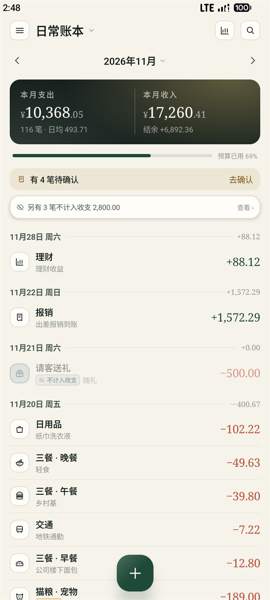
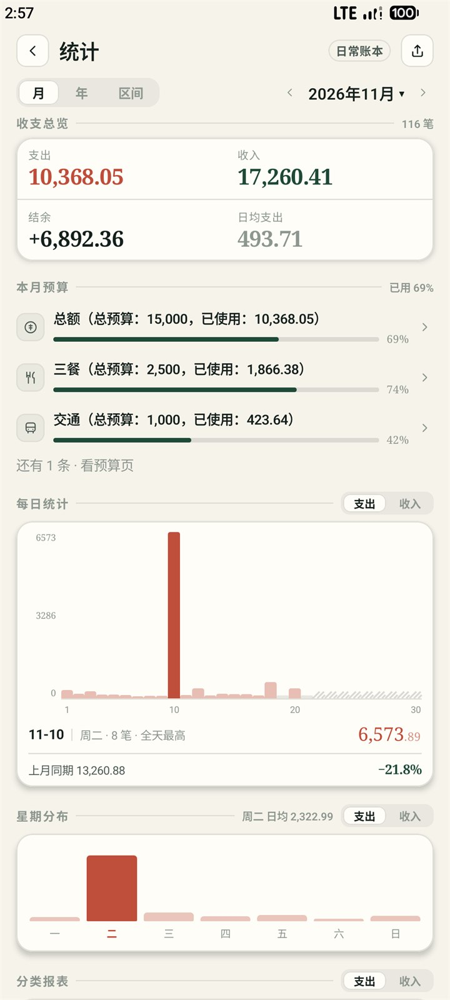
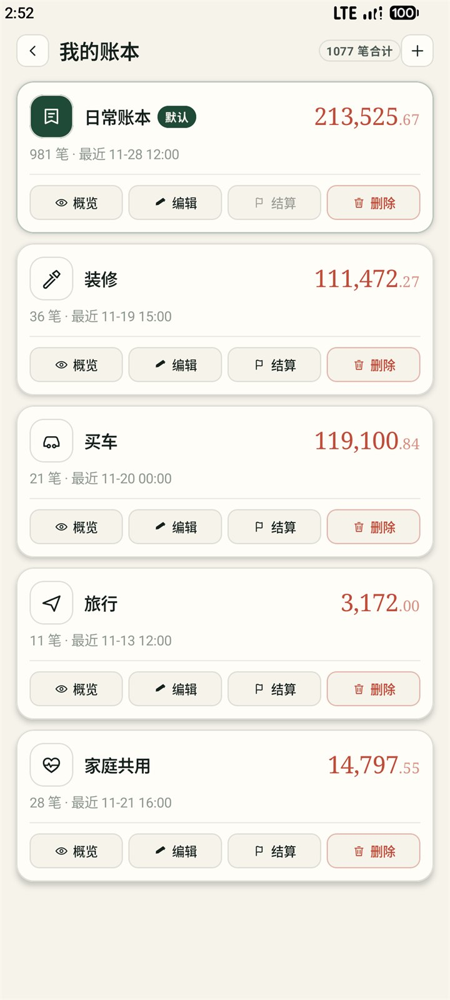
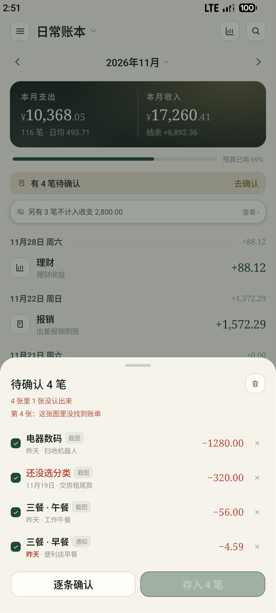
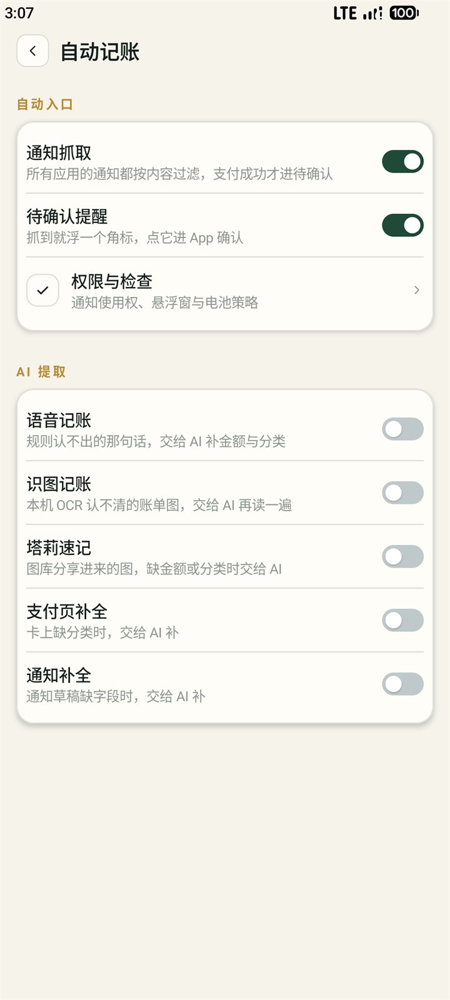
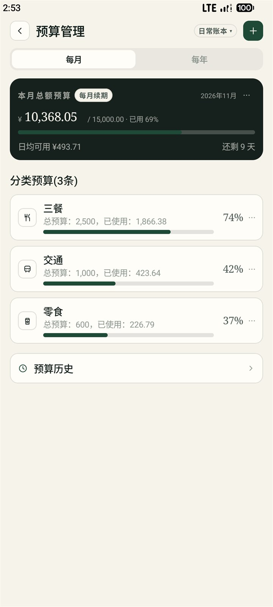
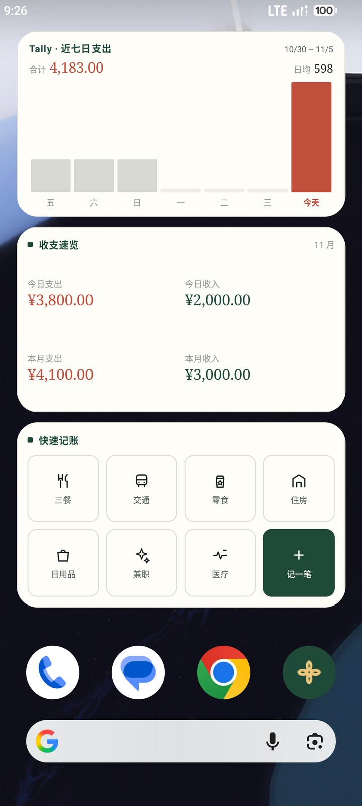

# Tally 塔莉

> 纯离线、功能多、AI 赋能。小莉帮你管好每一笔收支。

官网 <https://tally.guohang.asia> · 源码与发行包 <https://github.com/guohangbk/tally-app>

<p align="center">
  
  
  
  
</p>

## 它是什么

塔莉是一个单机自用的 Android 记账 App。没有账号，没有服务端，账单、分类、预算、备份都在本机。中文 OCR、口语金额解析、关键词规则先在本机跑；AI 提取是可选增强，默认关闭，外发前先脱敏。

机器只负责认字段，不负责替你落账：语音、识图、系统分享、付款通知、问小莉识别出来的账单，都会先进入待确认卡或账单卡，点确认后才进账本和统计。

## 六种记账方式

| 方式 | 怎么用 | 处理结果 |
| ---- | ------ | -------- |
| 手打 | 点中间的 ＋，选分类、输金额、保存 | 4×4 键盘支持 `38+12` 算式，日期、备注、标签、图片和账单时间同页填写 |
| 语音 | 长按 ＋ 上滑，按住说完松手 | 系统语音转写后本机解析金额、日期和关键词，出待确认卡 |
| 识图 | 长按 ＋ 左滑，从相册选图 | 一次最多 9 张，本机 OCR + 规则抽字段；需要时再走 AI 提取 |
| 塔莉速记 | 相册或文件里分享图片到 Tally | 回首页走同一张确认卡，不进对话；超过 9 张只收前 9 张 |
| 付款通知 | 开启通知抓取后照常付款 | 只认支付成功通知，解析金额、商户、订单号后进入待确认；推广和汇总不入账 |
| 问小莉 | 长按 ＋ 右滑打开对话 | 打字、说话、发图都可以；小莉给出账单卡，人工确认后才落账 |

所有自动入口共用一张待确认卡：缺分类的行标红置顶且不允许存入，点任意一行进记账页修改。没确认完退出或被杀进程也不丢，下次打开首页在预算条下继续处理。

<p align="center">
  
  
</p>

## 主要能力

- **多账本**：日常、装修、买车各记各的；首页和统计可切到「全部账本」看总账。
- **分类与关键词**：两级分类树全机共用；语音和识图保存的备注可沉淀成关键词规则，后续优先命中本机规则。
- **统计与搜索**：月、年、自定义区间；收支总览、预算段、趋势、星期分布、分类报表、日报；搜索支持时间、账本、来源、金额区间与排序。
- **批量操作**：长按账单进选择态，可批量改分类、标签、日期、备注、账本、报销状态、不计入或删除。
- **周期、分期、房贷与预算**：房租订阅按计划生成；分期末期自动处理分币尾差；房贷支持等额本息与等额本金；预算支持总额与分类维度。
- **标签与回收站**：标签跨账本通用；删除是软删，可在保留期内恢复。
- **桌面组件与长图**：多枚只读组件快速看数；统计和账本概览可导出脱敏长图。
- **备份与迁移**：`.tally` 加密备份包换机；CSV/XLSX 可导回；支持支付宝、钱迹、自有模板导入和 WebDAV 手动快照。

<p align="center">
  
  
  
</p>

## AI 提取与问小莉

AI 是两个独立能力：

- **AI 提取**：设置 → 自动记账里按入口开关控制。默认关闭，未配置服务商不允许开启。语音、识图、塔莉速记和通知补全在本机规则缺金额或缺分类时才调用 AI，外发的是脱敏文本，不是原图；AI 失败就退回规则结果。
- **问小莉**：长按 ＋ 右滑进入对话，可以打字、说话、发图。小莉返回的账单仍然要人工确认才落账。

自动记账不依赖 AI。不开 AI 时规则识别照常出待确认卡；开了 AI 只是少改几个字段。

## 权限与数据

| 权限    | 用途                        |
| ----- | ------------------------- |
| 网络    | 仅在主动配置 AI、WebDAV 或检查更新时使用 |
| 麦克风   | 语音记账                      |
| 通知    | 到期、失败和待确认提醒               |
| 悬浮窗   | 待确认角标；不给就不浮，不影响记账         |
| 通知使用权 | 系统里单独授权，付款通知自动进入待确认       |

通知原文不落盘、不进日志；自动草稿 30 天没人处理会退出待确认清单。诊断包不含金额、备注、分类名和 API Key。

## 下载与安装

历史版本在 Releases：<https://github.com/guohangbk/tally-app/releases>

| 项   | 要求                       |
| --- | ------------------------ |
| 架构  | 仅 `arm64-v8a`            |
| 系统  | Android 9（API 28）及以上     |
| 安装  | 浏览器下载后直接安装，首次需允许「安装未知应用」 |

## 本地构建

优先复用本机已有环境：`GRADLE_USER_HOME=E:\dev\repository\gradle`。Windows 上如遇 Gradle loopback 连接问题，用 `JAVA_TOOL_OPTIONS` 指定一个仓库内临时目录作为 `jdk.net.unixdomain.tmpdir`，跑完删除。

```powershell
$env:GRADLE_USER_HOME='E:\dev\repository\gradle'
.\gradlew.bat :tally-app:assembleRelease
.\gradlew.bat :tally-app:testDebugUnitTest
```

签名钥匙随仓库提供，可与本地 release 包互相覆盖安装。要用自己的钥匙，在 `local.properties` 里覆盖 `tally.keystore`、`tally.storePassword`、`tally.keyAlias` 和 `tally.keyPassword`。

## 文档与指南

- 使用指南：<https://tally.guohang.asia/guide.html>
- 对外文档：<https://github.com/guohangbk/tally-app/tree/HEAD/docs/release>
- 隐私说明：<https://github.com/guohangbk/tally-app/blob/HEAD/PRIVACY.md>

## 许可

BUSL-1.1。源码可读、可改、可自行构建、可个人自用；不得作为商业产品或服务提供给第三方。详见 [LICENSE](LICENSE)。
