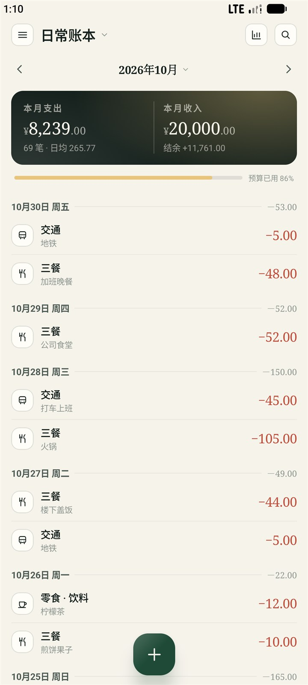
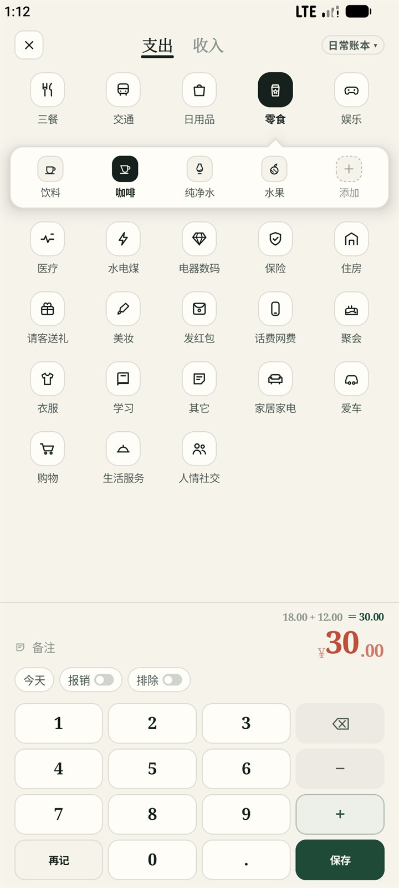
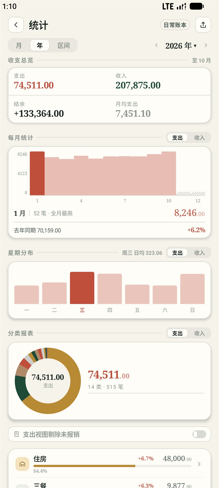

# Tally 塔莉

> 小莉帮你管好每一笔收支。

**一本只存在手机里的账本**：原生安卓的离线记账 App，数据只存在手机本地，没有账号、没有服务端。多账本与「全部账本」合并统计、预算提醒与自动续期、周期记账与分期（含房贷 LPR）到期自动入账、语音与截图记账全在端侧识别、导入导出与 `.tally` 加密备份换机、桌面三枚只读小组件与两条长按快捷方式。可选的 AI 小莉负责统计分析与对话式记账——不配置它，前面这些照样能用。

<p align="center">
  
  
  
  
</p>


## 仓库结构

```text
tally/
├── tally-app/              # Android 客户端（:tally-app，唯一应用模块）
├── docs/                   # 需求、架构、数据库、界面与使用文档，每份自包含
├── site/                   # 项目主页（单页 HTML + 截图资源，无构建）
├── gradle/                 # Gradle wrapper 与版本目录（9.6.0，走腾讯镜像）
└── LICENSE                 # BUSL-1.1
```

## 这是什么

**原生 Android 记账应用**：Kotlin + Jetpack Compose 写界面，Room 存本地库，不引跨端框架、不引 AI SDK、不引图表库——图表、金额键盘、海报、桌面组件都是自己画的。数据全部存在手机本地，没有账号、没有服务端。

### 记账方式

| 方式 | 怎么用 |
|---|---|
| 手打 | 4×4 金额键盘，支持 `38+12` 这类算式；两级分类、时刻、凭证图、备注 |
| 语音 | 长按 ＋ 上臂，说「二十九块八毛五」出 29.85，**端侧规则解析，可以不联网** |
| 截图 | 长按 ＋ 左臂，从相册选支付截图，端侧 OCR + 规则抽金额与商户，一次最多 9 张 |
| 周期 | 固定周期**到期自动入账**（房租、订阅、工资），错过的期数一次性「全部补记」；一次要补超过 100 期才停下来等确认 |
| 分期 | 一笔大额拆成多期，末期自动吃分币尾差；支持房贷（LPR±BP、等额本息 / 本金），到期同样自动入账 |
| 小莉（AI） | 可选增强：对话里一句话或几张图变成待确认的记账卡；不配置也不影响上面五条 |

### 账本与数据

- **多账本**：日常、装修、买车、结婚……各记各的，也能选「全部账本」一起看；账本只管钱归属哪件事，分类字典全机共用一套。
- **预算**：按月或按年设总额与分类额，可自动续期，往期有「预算历史」。
- **找回**：删除是软删，回收站按删除日分组，保留期自己设。
- **看账**：任意起止区间的统计（趋势、星期分布、分类二级小计、日报表下钻）、带金额区间与排序的搜索、七动作批量修改。
- **传出去**：桌面三枚只读组件、两条长按快捷方式、月度 / 年度 / 区间分享长图（可一键脱敏）。
- **换机与备份**：`.tally` 加密备份包导出后在任何设备上恢复；CSV/XLSX 导出可原样导回；支付宝 / 钱迹账单可批量导入，重复行在预览阶段就说破。

### 不做的事

账号体系、云同步、多端合并、账户与资产、转账、多币种、iOS、应用商店上架。系统已经提供的能力（应用锁、通知中心）不在 App 里做第二套。

## 文档

都在 [`docs/release/v0.1.0/`](docs/release/v0.1.0/) 下：

| 内容                               | 文档指引                                                                             |
|------------------------------------|--------------------------------------------------------------------------------------|
| 需求与验收标准                     | [`需求规格说明书.md`](docs/release/v0.1.0/需求规格说明书.md)                         |
| 架构、模块、技术选型、构建基线     | [`概要设计说明书.md`](docs/release/v0.1.0/概要设计说明书.md)                         |
| 逐功能 / 逐模块的处理逻辑与边界    | [`详细设计说明书.md`](docs/release/v0.1.0/详细设计说明书.md)                         |
| 表结构、索引、统计口径与版本策略   | [`数据库设计文档.md`](docs/release/v0.1.0/数据库设计文档.md)                         |
| 设计语言、组件与交互判据           | [`界面与交互规范.md`](docs/release/v0.1.0/界面与交互规范.md)                         |
| 界面长什么样（自包含，可离线打开） | [`界面设计图.html`](docs/release/v0.1.0/界面设计图.html)（29 节 / 117 屏）           |
| 为什么这么设计、否决过什么         | [`设计决策.md`](docs/release/v0.1.0/设计决策.md)                                     |
| 交给使用者看的说明书               | [`用户操作手册.md`](docs/release/v0.1.0/用户操作手册.md) + App 内「设置 → 使用指南」 |


## 本地构建

环境：**JDK 17+**（Gradle 的守护进程要 JDK 21，本机没有时 Gradle 会自己下载）+ **Android SDK `android-37.0`（API 37）**，Android Studio 或纯命令行都行。签名文件仓库里已经带了，克隆下来直接构建，不用先配任何东西；`local.properties` 不进 git——Android Studio 会自己写 `sdk.dir`，纯命令行则用 `ANDROID_HOME` 指定 SDK。

### 1. 签名：一把测试钥匙，随仓库走

Debug 与 Release 都走同一把签名钥匙，仓库里带的是 `tally-app/keystore/tally-unified.jks`——用 Android 调试那套公开常量生成（store/key 口令都是 `android`，别名 `androiddebugkey`）。它不是秘密，所以任何一次克隆都能直接出包。

> 这把钥匙只为了让大家装得上、能自己编。真要正式发版，请在仓库根的 `local.properties` 里用你自己的钥匙覆盖它，写四项（`tally.keystore` 是**相对 `tally-app/` 模块目录**的路径）：
>
> ```properties
> # local.properties —— 只存在于本机，不进 git
> tally.keystore=keystore/tally-unified.jks
> tally.storePassword=<你的 keystore 口令>
> tally.keyAlias=<你的别名>
> tally.keyPassword=<你的别名口令>
> ```
>
> 想换成自己那把 `~/.android/debug.keystore` 也一样，构建脚本不关心它是哪把。四项缺任何一项，Gradle 会直接报错并告诉你缺哪个键，不会静默走出一个没签名的包。

### 2. 构建

```powershell
.\gradlew.bat :tally-app:assembleDebug      # Windows
```

```bash
./gradlew :tally-app:assembleDebug          # macOS / Linux
```

产物：`tally-app/build/outputs/apk/debug/tally-app-debug.apk`，装到 `arm64-v8a` 的真机或模拟器即可。首次构建会从腾讯镜像拉 Gradle 与依赖，之后走本地缓存。

构建基线（AGP 9.4.1 / Gradle 9.6.0 / Kotlin 2.3.21 / KSP 2.3.12 / Compose BOM 2026.09.00 / Room 2.8.5 / compileSdk 37 + minor 0 / minSdk 28 / 仅 `arm64-v8a`）**互相咬死，不要单独升降其中任何一个**，原因见《概要设计说明书》§9.2。

## 验证方式

本项目不写自动化测试。改代码之后只有两条路：

1. 完整构建必须绿：`.\gradlew.bat :tally-app:build`（macOS / Linux 用 `./gradlew :tally-app:build`）。它包含编译、lint、debug 与 release 打包四步；
2. 真机 / 模拟器走查（交互验证一律用 Pixel 9 模拟器，AVD `Tally_API37`）。

单独出包与看报告：

- release 包：`.\gradlew.bat :tally-app:assembleRelease` → `tally-app/build/outputs/apk/release/tally-app-release.apk`（用仓库自带的测试钥匙签名，可覆盖安装）；
- lint 报告：`tally-app/build/reports/lint-results-debug.html`。

## 许可

**BUSL-1.1**（Business Source License 1.1）——属于 **Source-Available（源码可用许可 / 商业源码许可）**，不是 OSI 定义的开源许可。可读、可改、可自行构建、可个人自用；不得作为商业产品或服务提供给第三方。每个版本在 Change Date（最早 2030-11-01，或该版本首次公开分发满四年）自动转为 GPL-2.0-or-later。详见 [LICENSE](LICENSE) 与 App 内「设置 → 许可与依赖」。
